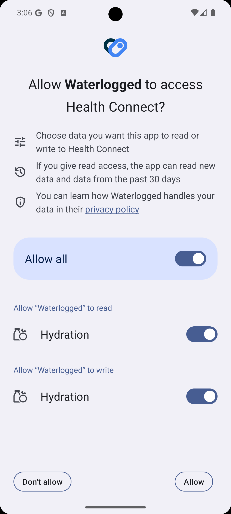
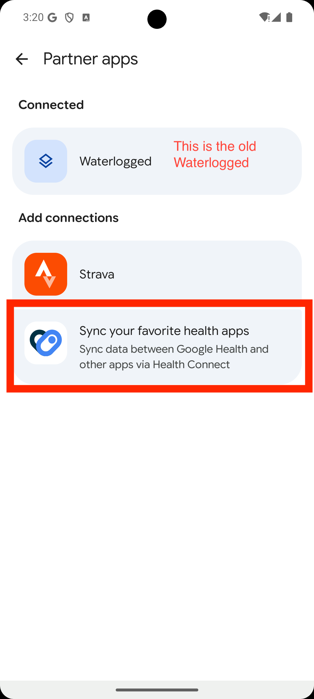
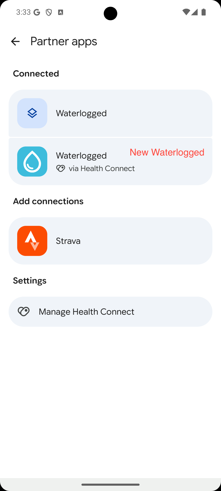
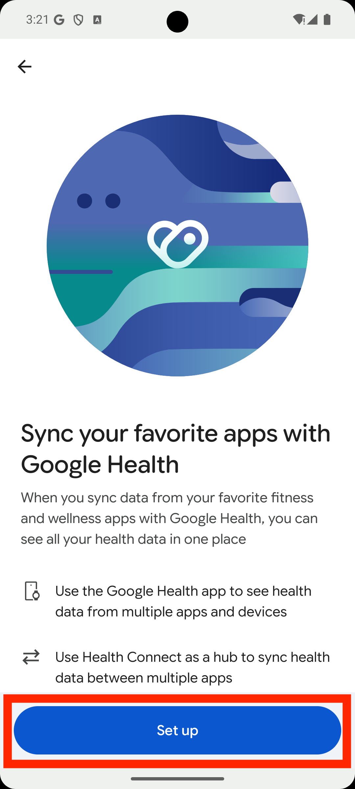
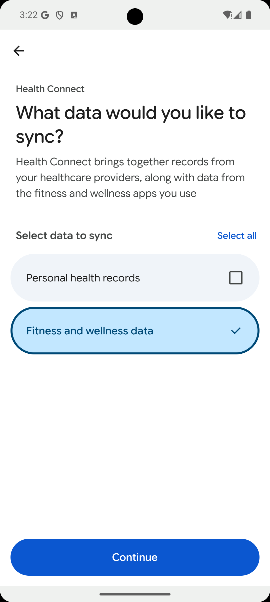
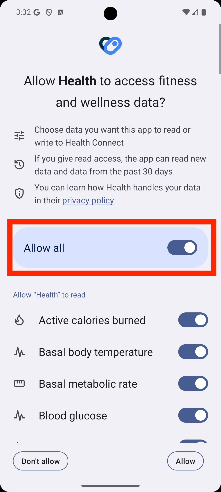
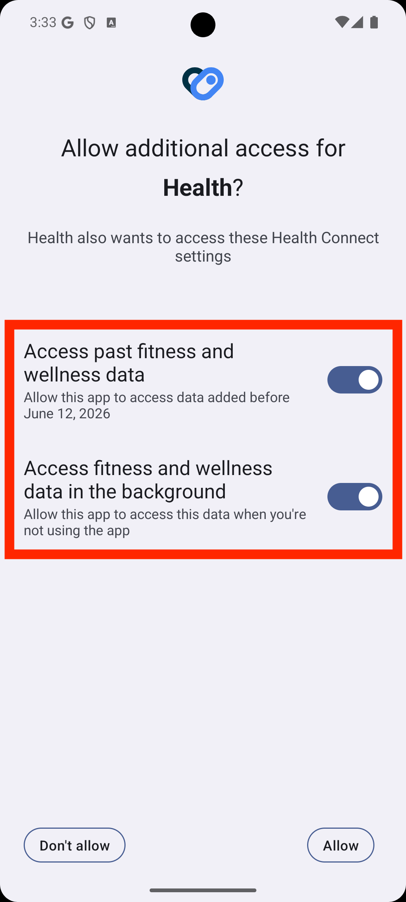

# Waterlogged

## Download

## Screenshots

## Overview

Waterlogged is a Wear OS Tile that allows quick and easy recording of your water intake directly to **Health Connect**, syncing seamlessly with Google Health, Fitbit, Samsung Health, and other compatible apps.

## Features

- Syncs data natively and securely via Android's Health Connect APIs.
- The tile provides three buttons to quickly record your water intake - a glass of water, a bottle of water, and a large bottle.
- The preset water amounts and your daily goals are customisable in the companion phone app.
- A progress bar around the outside of the tile indicates your progress towards your daily water goal.
- Background sync resilience ensures that if you log water on your watch while away from your phone, it will seamlessly upload all your logs once Bluetooth reconnects.

## Requirements

- Wear OS device paired to an Android phone
- Health Connect installed on the phone (built-in on Android 14+)

## Installation

Download from [the Google Play Store](https://play.google.com/store/apps/details?id=com.hrb116.waterlogged).

## Usage

1. Install the app on both your Android phone and your Wear OS watch.
2. Open the **Waterlogged** app on your phone. You will be guided through a simple setup process to link Waterlogged with Health Connect and Google Health (exact steps may vary according to your device):
      
    **Step 1:** Approve the Health Connect permissions request.
     
      
    **Step 2:** Open Google Health, go to Partner Apps, and validate that you see Waterlogged as 'connected with Health Connect'.
      
      
    **Step 3:** If you don't see it, tap 'Sync your favourite health apps' and tap through the consent forms.
     
      
    **Step 4:** Select 'Fitness and wellness data' -> 'Nutrition' to allow Health Connect Nutrition data to sync to Google Health.
       

3. Go to the Watch app on your smartphone. Open "Tiles", tap "Add Tiles", and find Waterlogged's "Quick add water" tile. 
4. Swipe on your watch to locate your new tile. It will present three buttons for quick recording water. You're ready to go!
5. To edit the preset values, open the **app** on your phone to configure your glass sizes and daily goal, then tap "Sync Settings to Watch".

## Privacy and security

The app integrates with Android's Health Connect API to read and write Hydration data locally on your device. We do not transmit or store your personal health data on any external servers.

## Contributions

All contributions are welcome! If you'd like to contribute, please fork the repository and make changes as you'd like. Pull requests are welcomed.
